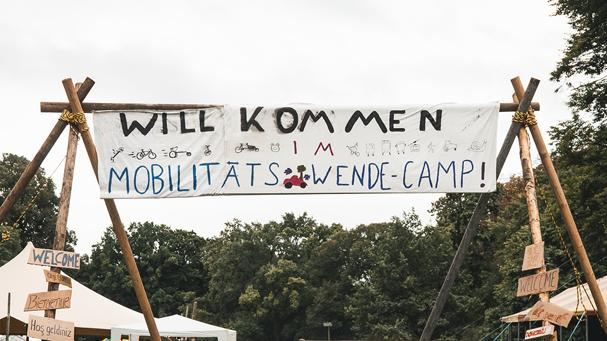

From September 9 to 14, 2025, the Mobility Transition Camp took place in
Luitpoldpark.

As early as the previous weekend, volunteers began receiving material
deliveries and making preparations for setting up the camp. Despite some rain
on Friday, the sunny weekend allowed for smooth tent setup. As a result, the
infrastructure — including the tents for the kitchen, the program, the awareness
area, the press, and the paramedics  — was completed on time.

To make the camp more accessible, we laid floor panels between the tents for
the first time, creating paths across the meadow. The interiors of the tents
were also partially lined with these floor panels, and we were pleased to see
that several wheelchair users took advantage of this.

On Tuesday afternoon, we declared the gathering open at around 4 p.m. The first
workshops, readings, and lectures took place. The “Kitchen for All” run by the
cooking collective Knoblauchfahne provided delicious vegan meals.

From Tuesday through Sunday, the camp offered a very diverse educational
program with around 80 events. It consisted of lectures, readings, workshops,
and music. The main topics were climate justice, activism, and civil society.
Sign language interpretation was provided for selected events.

Every day, educational activities took place in our program tents from 10 a.m.
until the early evening. On Friday, we organized a “Market of Opportunities,”
where initiatives, associations, and collectives could present themselves and
their work. On Saturday, under perfect weather conditions, the bike
demonstration took place, followed by a march through the city. Toward the late
afternoon, the demonstration procession ended at the campgrounds.

From Monday, September 15, through Wednesday, September 17, the camp was taken
down with the help of many volunteers, and the area in the park was left clean
again.

**Conclusion**

The camp received positive feedback in the park, and we had good conversations
with interested residents, park visitors, and camp attendees.

However, the weather conditions were not ideal for a camp. Repeated rain and
temperatures ranging from 12 degrees at night to just over 18 degrees during
the day had a noticeable impact on attendance and, consequently, on the amount
of donations collected.

During the follow-up phase, the donations collected were used to cover
outstanding invoices. These include infrastructure costs such as the Kompotoi
toilets, the rented floor panels, and the stage equipment for the tents, as
well as transportation costs incurred for the materials.

**We would like to express our heartfelt thanks** to all the volunteers,
supporters, visitors, and participants who made the camp possible and brought
it to life .

**The 2025 Camp Organizing Committee**

P.S.: The next IAA will take place in 2027

